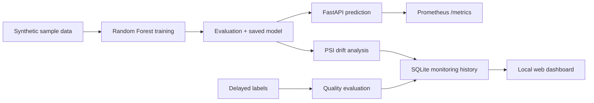

# MLOps & AI Observability Platform

**Reproducible portfolio/reference implementation; not certified for real production workloads.**

[](https://github.com/Akbar453/mlops-drift-monitoring-prototype/actions)

## Architecture


## Features
- Deterministic classification training; holdout evaluation with ROC-AUC, average precision, accuracy
- Batch `/predict`, `/monitor` (feature-wise PSI), `/monitor/performance` (delayed labels), `/monitor/history`
- FastAPI Swagger at `/docs`, local HTML dashboard at `/dashboard`, Prometheus metrics at `/metrics`
- Optional API-key auth via `MLOPS_API_KEY` and `X-API-Key` header (not a replacement for gateway/OIDC)
- SQLite aggregate audit events; no raw inference feature/label storage
- Optional MLflow local experiment run (`pip install -r requirements-tracking.txt`, `python track_experiment.py`)
- Container image with unprivileged user/healthcheck, Compose, automated unit/API tests and GitHub Actions

## Run on Windows PowerShell (Python 3.11 suggested)
```powershell
py -3.11 -m venv .venv
.\.venv\Scripts\python.exe -m pip install -r requirements-dev.txt
.\.venv\Scripts\python.exe train.py
.\.venv\Scripts\python.exe -m pytest -q
.\.venv\Scripts\python.exe -m uvicorn src.api:app --host 127.0.0.1 --port 8000
```
Open `http://127.0.0.1:8000/dashboard` and `http://127.0.0.1:8000/docs`.

## Docker
```powershell
docker build -t mlops-observability:local .
docker run --rm -p 127.0.0.1:8000:8000 mlops-observability:local
```
Or `docker compose up --build -d`. Monitoring history is persisted in a named volume at `/app/state`; training artifacts stay within the image.

## Examples
```powershell
$payload = @{records=@(@{features=@(0.5,1.2,-0.3,0.1,2.0)})} | ConvertTo-Json -Depth 6
Invoke-RestMethod http://127.0.0.1:8000/predict -Method Post -ContentType application/json -Body $payload
python demo.py | Set-Content -Encoding utf8 drift.json
Invoke-RestMethod http://127.0.0.1:8000/monitor -Method Post -ContentType application/json -InFile drift.json
```
If you enable `MLOPS_API_KEY`, supply an `X-API-Key` header for all protected endpoints.

## Demonstrated versus NOT included
| Implemented | Not yet production-hardened |
|---|---|
| Holdout training, PSI, delayed-label metrics, history, API, dashboard, Prometheus, Docker & CI config | Real production data, model registry, multi-tenant RBAC, TLS/reverse proxy, managed secrets, durable external DB, alert delivery, SLO validation, load tests, blue-green deployments |

**Important limitations:** training uses synthetic sklearn-generated features, not genuine sensor units. No model quality claims transfer to real data. PSI depends on sample size/binning and thresholds must be calibrated. Feedback endpoint only computes *batch aggregate* metrics; it cannot join delayed labels to historical predictions. Never accept untrusted joblib model files. Keep API private, configure auth and upstream TLS before exposure. Docker Compose persists only SQLite state at `/app/state`; for production replace SQLite with a managed database and deploy the model as a versioned, trusted artifact.

## Next engineering milestones
Instrument request IDs/OpenTelemetry, calibrated failure alerts with delivery, offline evaluation datasets, versioned model registry, Postgres events, security scans, multi-instance deployment, retraining approval workflow.
